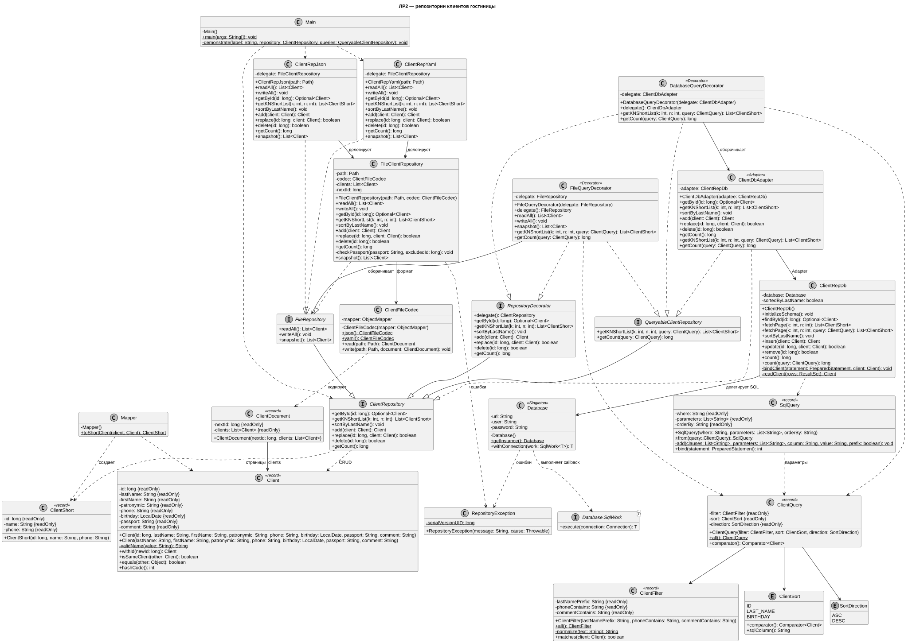

# ЛР2 — репозитории клиентов гостиницы

Доработка сущности клиента из ЛР1. `лаб1` сохранена отдельно. Поля пола нет. ID добавлен для поиска и изменения записей по заданию ЛР2; равенство клиентов по-прежнему определяется нормализованным паспортом. Модель неизменяемая: клиент не позволяет обойти репозиторий и незаметно изменить паспорт или ID.

## Запуск

Нужны JDK 17+ и Maven, для SQL-части — PostgreSQL. Команды выполняются из папки `лаб2`:

```sh
mvn verify
mvn exec:java
```

Первая команда запускает Checkstyle, проверку форматирования Spotless и тесты JSON/YAML без PostgreSQL. Вторая показывает файловые репозитории и декораторы. Файлы `data/runtime-demo.*` создаются автоматически и исключены из Git.

Для SQL-части:

```sh
docker compose up -d --wait
mvn -Ppostgres verify
mvn exec:java -Dexec.args="--db"
```

Compose использует PostgreSQL 17 на `127.0.0.1:54329`, БД `hotel_lab2`, учебного пользователя `hotel` и пароль `hotel_lab2_dev`. Другое подключение задаётся переменными `LAB2_DB_URL`, `LAB2_DB_USER`, `LAB2_DB_PASSWORD` — см. `.env.example`. Java не читает `.env` автоматически: экспортируйте переменные в окружение.

Профиль `postgres` запускает интеграционные тесты на настоящем PostgreSQL. Они очищают учебную таблицу `lab2_clients`; используйте отдельную учебную БД. `initializeSchema()` создаёт эту таблицу, если её нет. Для завершения сервера: `docker compose down` (данные именованного тома сохраняются).

## Соответствие заданию

| Пункт | Реализация |
|---|---|
| 1 | `ClientRepJson`: чтение/запись, поиск, страницы, сортировка, добавление, замена, удаление, количество |
| 2 | `ClientRepYaml`: те же операции для YAML |
| 3 | Общий контракт `ClientRepository` / `FileRepository`; общая файловая логика в `FileClientRepository`, формат в `ClientFileCodec` |
| 4 | `ClientRepDb`: PostgreSQL через JDBC, только SQL, без ORM и SQLite |
| 5 | `Database`: ленивый потокобезопасный Singleton, которому делегированы соединения |
| 6 | `ClientDbAdapter`: объектный Adapter к общему контракту |
| 7* | `DatabaseQueryDecorator`: фильтр, сортировка и согласованный COUNT в SQL |
| 8** | `FileQueryDecorator`: те же запросы для JSON/YAML |
| 9 | Checkstyle, Spotless/Eclipse, форматирование, тесты и итоговая диаграмма |

По уточнению к заданию прямого наследования конкретных классов нет. Общая иерархия типов построена интерфейсами, а бизнес-логика вынесена в делегаты. `RepositoryDecorator` содержит делегирующие default-методы обычного CRUD; декораторы добавляют перегрузки запросов.

## API и правила

- `getById(id)` возвращает `Optional<Client>`; для отсутствующего ID — `Optional.empty()`. Замена и удаление отсутствующего ID возвращают `false`.
- `getKNShortList(k, n)` соответствует `get_k_n_short_list`. Страницы нумеруются с 1: `(2, 20)` — элементы 21–40. Неположительные аргументы отклоняются; страница за концом списка пуста.
- `getCount()` соответствует `get_count`. Дополнительные перегрузки принимают `ClientQuery`.
- Файловые репозитории читают существующий файл в конструкторе. `readAll()` повторяет чтение, `writeAll()` сохраняет текущее состояние. После файлового CRUD для сохранения вызывайте `writeAll()` явно. В БД изменения сразу выполняются SQL-запросом.
- JSON/YAML хранят `nextId` и массив `clients`. Удалённые ID не используются повторно после перезапуска. PostgreSQL выдаёт ID через identity; пропуски после неудачных вставок допустимы.
- Паспорт уникален. Входной ID при добавлении заменяется новым; при замене сохраняется ID целевой записи.
- `sortByLastName()` задаёт порядок по фамилии, затем по ID. В БД это `ORDER BY`, а не физическая перестановка строк.
- `ClientFilter`: начало фамилии, фрагмент телефона и комментария. Условия объединяются через AND, регистр не учитывается, пустые условия означают все записи. `%`, `_` и `\` — буквальные символы.
- `ClientSort`: `ID`, `LAST_NAME`, `BIRTHDAY`; направление — `ASC` / `DESC`. При совпадении выбранного поля используется ID по возрастанию.
- Фильтр и сортировка применяются до выделения страницы. `getCount(query)` считает все совпадения; сортировка на число не влияет.
- SQL-значения передаются через `PreparedStatement`, поле/направление сортировки выбираются из enum. `ResultSet` обрабатывается и закрывается внутри операции.
- Повреждённый файл отклоняется целиком, текущее состояние памяти сохраняется. Запись выполняется через временный файл. Файловая реализация рассчитана на один управляющий экземпляр на файл, без межпроцессной синхронизации.
- Ограничения возраста 18–110 лет и паспорта из 10 цифр сохранены из ЛР1 как правила учебной модели.

Пример запроса:

```java
ClientRepJson storage = new ClientRepJson(Path.of("data/clients.json"));
FileQueryDecorator repository = new FileQueryDecorator(storage);
ClientQuery query = new ClientQuery(
        new ClientFilter("ив", null, null), ClientSort.LAST_NAME, SortDirection.ASC);
List<ClientShort> page = repository.getKNShortList(1, 20, query);
long count = repository.getCount(query);
```

Пример адаптера:

```java
ClientRepDb sql = new ClientRepDb();
sql.initializeSchema();
ClientDbAdapter adapter = new ClientDbAdapter(sql);
ClientRepository common = adapter;
DatabaseQueryDecorator queries = new DatabaseQueryDecorator(adapter);
```

Образцы данных: `data/clients.json`, `data/clients.yaml`.

## Проверки и диаграмма

```sh
mvn spotless:apply
mvn verify
mvn -Ppostgres verify
```

Checkstyle проверяет имена, импорты, модификаторы, пустые операторы и согласованность `equals/hashCode`. Spotless проверяет форматирование исходников и тестов. Оба включены в обычную сборку, замечания приводят к её ошибке.



Редактируемый исходник: `docs/class-diagram.puml`. Пунктир с пустым треугольником — реализация интерфейса, сплошная линия с треугольником — расширение интерфейса; обычная стрелка — ссылка/делегация. Конкретные классы друг от друга не наследуются.

Ответы на все теоретические вопросы: [docs/theory.md](docs/theory.md).
